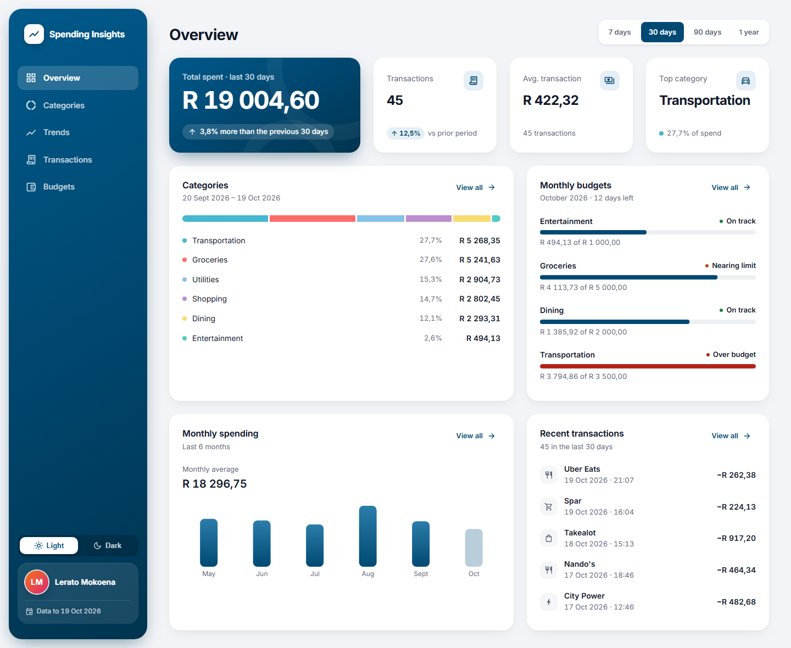
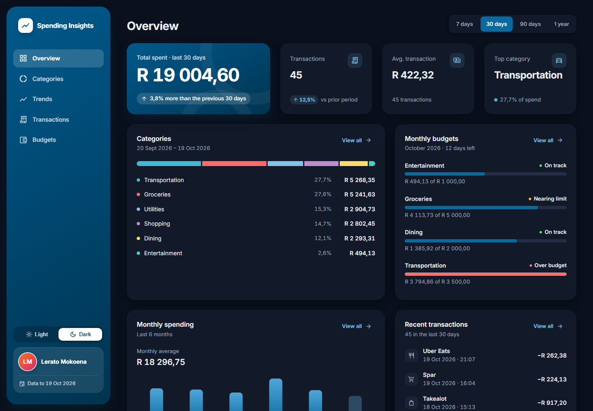
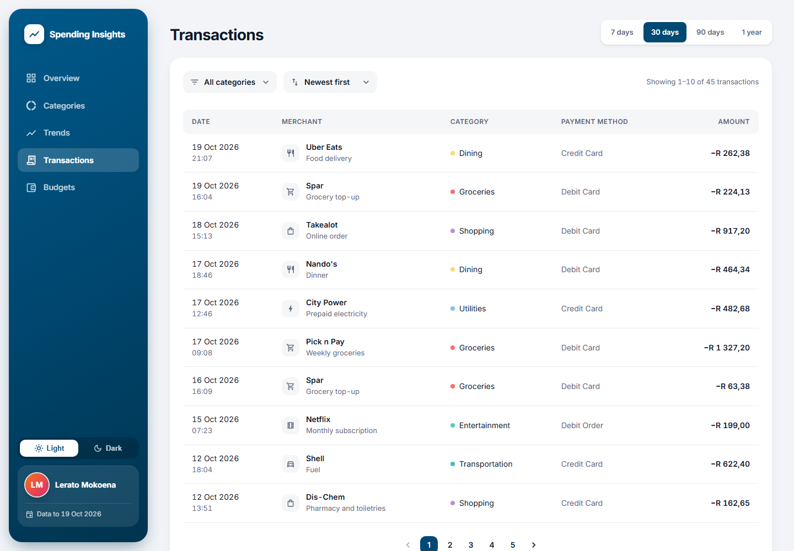
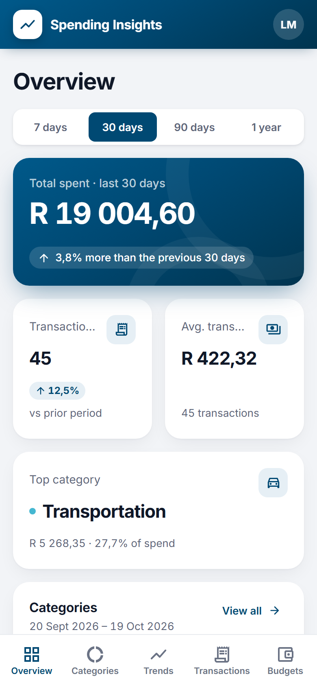
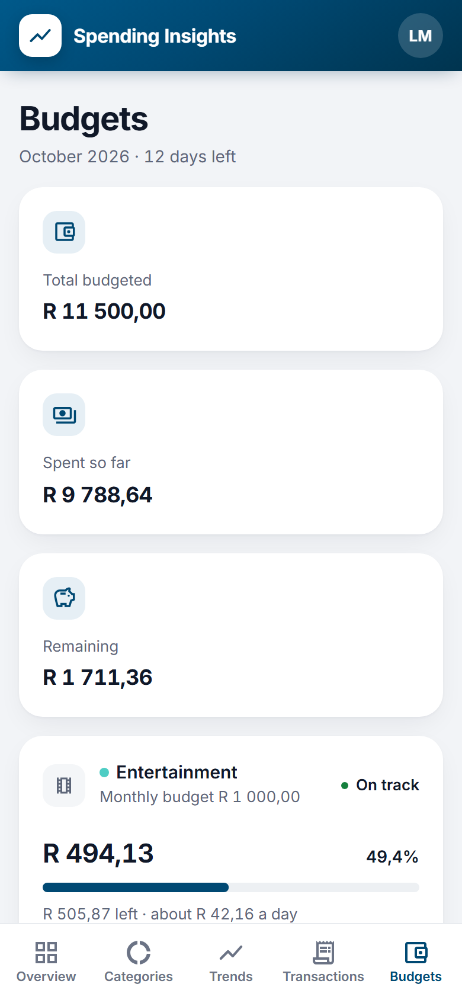

# Customer Spending Insights Dashboard

A responsive dashboard that helps a banking customer understand **how much they spend, where it goes, how it changes over time and whether they are staying within their monthly budgets**.

Built with **React 18, TypeScript (strict), Material UI, TanStack Query and Recharts**, backed by a **TypeScript Express mock API** that implements every endpoint in the supplied contract ([docs/api-contract.md](docs/api-contract.md)). One Docker container serves both the UI and the API.

> **Take-home assessment (Software Engineer: UX Developer).** This is a concept demonstration, not an official banking product. The customer, merchants and transactions are fictional and generated deterministically.





| Transactions tab                                                                                                            | Phone: Overview                                                                                                  | Phone: Budgets (dark)                                                                             |
| --------------------------------------------------------------------------------------------------------------------------- | ---------------------------------------------------------------------------------------------------------------- | ------------------------------------------------------------------------------------------------- |
|  |  |  |

---

## Quick start

### With Docker (recommended for reviewers)

```bash
docker build -t spending-insights .
docker run --rm -p 3000:3000 spending-insights
```

Open <http://localhost:3000>. The API is served from the same container, for example:

```bash
curl "http://localhost:3000/api/customers/12345/spending/summary?period=30d"
```

The image is a multi-stage build. The runtime stage holds only the compiled UI and one bundled server file (no `node_modules`), runs as the non-root `node` user, and has a `HEALTHCHECK` against `/api/health`.

### Locally

Requirements: **Node.js 20.19+** (22 LTS recommended; see `.nvmrc`) and npm.

```bash
npm ci
npm run dev        # UI on http://localhost:5173, mock API on http://localhost:3001 (proxied under /api)
```

Production build, run locally:

```bash
npm run build      # dist/ (React) + dist-server/index.cjs (Express)
npm start          # serves both on http://localhost:3000
```

## Testing and quality checks

| Command                 | What it runs                                                                                       |
| ----------------------- | -------------------------------------------------------------------------------------------------- |
| `npm run typecheck`     | `tsc -b` across the UI, server, shared and test projects (strict mode, `noUncheckedIndexedAccess`) |
| `npm run lint`          | ESLint, including `typescript-eslint`, React Hooks and `jsx-a11y`; zero warnings allowed           |
| `npm run format:check`  | Prettier                                                                                           |
| `npm test`              | Vitest: unit, API (Supertest) and component (React Testing Library) tests                          |
| `npm run test:coverage` | The same, with V8 coverage                                                                         |
| `npm run test:e2e`      | Playwright against the production build, on desktop (1440 px) and mobile (Pixel 7) Chromium        |
| `npm run verify`        | typecheck, lint, format, test and build in one go                                                  |

The first time you run end-to-end tests, install the browser with `npx playwright install chromium`. `test:e2e` builds the app and starts the production server itself. Set `E2E_SKIP_BUILD=1` if you have already run `npm run build`.

**What is covered**

- **Unit:** date boundaries in Africa/Johannesburg (including UTC instants that fall on the next local day), leap years, equal-length previous periods, percentage change with a zero denominator, rounding (`1.005 → 1.01`), category tie-breaking, zero-spend months, goal thresholds (79.99 / 80 / 100 / 100.01 %), stable sorting, pagination without gaps or duplicates, URL-filter parsing and fallbacks, currency/percentage/date formatting, and trend insights.
- **Data consistency:** for every period, summary total = category total = transaction count, percentages sum to about 100 %, and the dataset is identical on every generation.
- **API:** every endpoint's response shape, defaults, filtering, sorting and pagination; 400s for each invalid parameter; 404s for unknown customers and routes; no stack traces leaked; `Cache-Control: no-store` and security headers.
- **Components:** loading, success, error with retry (which really re-requests), and empty states; labelled filter controls; category rows; accessible goal progress; one failing endpoint not breaking other cards; tab navigation updating URL, title and focus; and category selection opening filtered transactions. Tests render against the real mock API on an ephemeral port, with per-test overrides for failures.
- **End-to-end:** first load with no console errors; every tab reachable from the navigation, with back-button support; Overview cards open their tabs; period change updates figures and URL across tabs; category → filtered transactions → sort → paginate → refresh restores the view; invalid URL parameters fall back to defaults; **no horizontal scroll and an axe-core WCAG 2.2 AA scan with zero serious/critical violations on every tab**; API failure and recovery; empty results with "Clear filters"; a keyboard-only flow through the sidebar menu.

CI ([.github/workflows/ci.yml](.github/workflows/ci.yml)) runs all of the above on every push and pull request, then builds the Docker image and smoke-tests the running container.

---

## Features

The app is organised like a modern banking app: an **Overview** dashboard plus four focused tabs (**Categories, Trends, Transactions, Budgets**). Each Overview card summarises one area and links to its tab, so you see the headline numbers at a glance and open the detail only when you want it. On desktop the sections are a floating sidebar menu; on phones they become a bottom tab bar.

- **Overview.** Total spent for the selected period as the hero figure, with a neutral comparison to the previous equal-length period, plus transaction count, average transaction and top category. Below it: where the money went (one proportion bar and a legend), monthly budgets at a glance, a six-month mini trend and the five most recent transactions.
- **Global period filter** (7 days / 30 days / 90 days / 1 year) shared by Overview, Categories and Transactions, so the numbers always describe the same date range.
- **Categories.** A donut chart with the total, and a breakdown listing each category's amount, share and transaction count. Selecting a category opens the Transactions tab filtered to it.
- **Trends** (6 / 12 / 24 months), independent of the period filter. Stat cards for the monthly average and highest/lowest month; a bar chart where the in-progress month is drawn lighter and excluded from the average; plain-language takeaways and a toggleable data table, so the insight never depends on reading the chart or hovering.
- **Transactions.** Category filter, four sort orders and pagination. A semantic table on desktop; day-grouped cards on mobile, which are not grouped when sorting by amount. An announced "Showing 11–20 of 132" status. The current page stays visible while the next one loads.
- **Budgets.** Month-to-date totals, then one card per budget with "On track" / "Nearing limit" / "Over budget" in words, progress, and a suggested daily allowance for the rest of the month ("R 886,27 left · about R 73,86 a day").
- **Shareable, app-like navigation.** The active tab and every filter are kept in the URL (`?view=transactions&period=90d&category=Groceries&sortBy=amount_desc&page=2`). Refresh restores the view, the browser back button moves between tabs, and each tab is a real link (it can be opened in a new browser tab). Invalid values fall back safely.
- **Resilient cards.** Each card has its own skeleton, error-with-retry and empty state. A failing endpoint never blanks the rest of the page. An error boundary catches unexpected rendering failures.

## Visual design

- **Depth instead of lines.** Cards have no borders; they sit on a cool grey canvas with soft layered shadows, a 20px radius and the same 24px inner padding everywhere. Grid gaps are 24px on desktop.
- **Contrast that guides the eye.** Capitec blue (`#004973`) is used sparingly but boldly: the floating sidebar (blue header on phones), the total-spent hero card and the selected period. Everything else is white or grey, so the blue surfaces read first.
- **One accent.** Charts use a blue gradient; budget progress is blue, turning red only when a budget is exceeded. Category colours (from the API contract) appear only as small dots, chart slices and proportion bars, always next to the category name. Status is a small dot plus words.
- **Modern controls.** Pill-shaped filter selects with an icon and no floating label (the accessible name is still provided), a segmented period picker, and "View all" links in card headers.
- **Typography.** Self-hosted Inter, tabular numerals so amounts line up, and minimal copy: labels and numbers rather than explanatory sentences.
- **Light and dark modes.** Light is the default; the choice (sidebar switch on desktop, header button on phones) is remembered on the device. Each mode has its own palette exposed as CSS custom properties, so one switch re-themes every surface; charts read concrete colours for SVG. Both modes pass the automated WCAG 2.2 AA scan on every screen.
- **Navigation chrome.** A floating brand-blue sidebar with a light/dark switch and a profile card with a gradient initials avatar chosen from the customer's name. On phones: a brand header and a floating, blurred tab bar where the active tab gets a pill indicator.
- **Tooltips where they add information**, not decoration: the full sentence behind a change badge, what each budget status means, the figures behind each proportion-bar segment, the meaning of the demo data date, and labels for icon-only buttons. Every tooltip target is keyboard-focusable or duplicates text that is already accessible.

## Architecture

```text
├── shared/                 Contract types, category metadata and calendar-date helpers used by both sides
├── server/
│   ├── data/               Seeded PRNG, deterministic ledger generator, fictional customer and budgets
│   ├── utils/              Pure functions: periods, aggregation, % change, goals, sorting, pagination, rounding
│   ├── services/           insights-service: derives every endpoint response from one ledger + reference date
│   ├── routes/             Thin Express handlers: validate (Zod) → call service → JSON
│   ├── validation.ts       Query-parameter schemas with readable messages
│   ├── app.ts              Security headers, compression, /api router, static files + SPA fallback
│   └── index.ts            Config, listen, graceful shutdown
├── src/
│   ├── views/              One component per tab: Overview, Categories, Trends, Transactions, Budgets
│   ├── components/         layout/ (app shell: sidebar, mobile bars, page header), overview/ (summary cards), transactions/, states/, common/
│   ├── navigation.ts       Tab definitions
│   ├── hooks/              useDashboardFilters (tab + filter URL state), useInsightsQueries (TanStack Query)
│   ├── services/           Typed fetch client with ApiError; QueryClient defaults
│   ├── theme/              Design tokens and MUI theme
│   └── utils/              Formatting (en-ZA, ZAR, Africa/Johannesburg), insight copy, accessibility helpers
├── tests/                  unit/, api/, components/, e2e/, fixtures/
└── Dockerfile, .github/workflows/ci.yml
```

**Key decisions**

- **One source of truth.** The contract's example payloads are illustrative and not mutually consistent (for example, the category counts add up to 53 while the summary says 47). Rather than hard-coding them, the server generates one seeded ledger of about 1,000 transactions from July 2024 to the demo date and computes every response from it. That guarantees totals agree across endpoints.
- **Money in integer cents** on the server, converted to Rand only at the response boundary, so sums never drift.
- **A frozen demo clock.** The data runs to **19 October 2026** (`DEMO_REFERENCE_DATE` overrides it). Screenshots, numbers and tests are therefore reproducible, and the UI shows "Demo data to 19 Oct 2026".
- **Timezone-correct calendar logic.** Transactions are stored as UTC instants. All filtering and grouping uses the Africa/Johannesburg calendar date (for example, a delivery at 00:30 SAST counts on that local day, not the previous UTC day).
- **Server-side calculations.** The browser never downloads the whole ledger to compute four metrics. The UI only formats data and decides how to present it.
- **Service/handler separation.** Route handlers are a few lines each. To use a real upstream API, swap `insights-service` for an HTTP client with the same interface; the routes and UI stay unchanged.
- **No global client store.** TanStack Query owns server state, with query keys that include every parameter (so fast filter changes can never mix responses). The URL owns filter state, and React state handles the rest. Redux would add nothing here.
- **Retry policy.** Network and 5xx errors retry with backoff; 4xx errors do not.

### API contract extensions

All seven contract endpoints keep their documented shapes. Where the contract was silent, these additions are documented here rather than made silently:

| Change                                                                                                  | Why                                                                                                                                |
| ------------------------------------------------------------------------------------------------------- | ---------------------------------------------------------------------------------------------------------------------------------- |
| `GET /transactions?period=7d\|30d\|90d\|1y` (optional, mutually exclusive with `startDate`/`endDate`)   | Lets the transaction list use exactly the same server-resolved range as the summary, without the client re-implementing date logic |
| `spentChange` / `transactionChange` may be `null`                                                       | The previous period had nothing to compare with; the UI says so instead of showing `Infinity%`                                     |
| `topCategory` may be `null`                                                                             | No spending in the period                                                                                                          |
| Goal `status` adds `exceeded` (> 100 %) alongside `on_track` (< 80 %) and `warning` (80–100 %)          | A budget can be overspent                                                                                                          |
| `category` filter is case-insensitive; unknown categories return 400                                    | Friendlier input, explicit errors                                                                                                  |
| `GET /api/health`, `GET /api/meta` (`dataAsOf`, `timezone`, `currency`)                                 | Container health check; lets the UI label the demo date and the in-progress month                                                  |
| Errors: `{ "error": { "code", "message", "details?": [{ "field", "message" }] } }` with 400 / 404 / 500 | Consistent, safe error bodies                                                                                                      |

Only customer `12345` exists. Other IDs return 404.

## UX and accessibility

- Mobile-first layout, checked from 360 px to 1440 px with no horizontal scrolling on any tab.
- Tab changes behave like page changes: the document title updates, the page scrolls to the top, and focus moves to the new tab's heading, so screen-reader and keyboard users know where they are. The sidebar menu items are links marked with `aria-current`.
- Plain-language copy with the comparison basis spelled out ("3,8% more than the previous 30 days"). Increases are not coloured red, because spending more is not automatically bad.
- Rand formatted with `Intl.NumberFormat('en-ZA', { currency: 'ZAR' })` everywhere. Expenses are shown as debits (−R 262,38).
- Semantic landmarks and headings, labelled `section` regions, a skip link, visible focus rings, labelled form controls, and announced loading and result-count status.
- Charts: the donut has a text summary and a full list equivalent; the trend has written takeaways and a data table. Category colours are never used as text colour (several are too light for text contrast), and status is always stated in words.
- `prefers-reduced-motion` disables chart and UI animations.

## Configuration

| Variable              | Default                                     | Purpose                                                            |
| --------------------- | ------------------------------------------- | ------------------------------------------------------------------ |
| `PORT`                | `3000` in production, `3001` in development | Server port                                                        |
| `HOST`                | `0.0.0.0`                                   | Bind address                                                       |
| `DEMO_REFERENCE_DATE` | `2026-10-19`                                | Last day of demo data                                              |
| `API_LATENCY_MS`      | `0`                                         | Development only: artificial API delay for checking loading states |
| `VITE_CUSTOMER_ID`    | `12345`                                     | Build-time customer ID used by the UI                              |

No secrets, databases or external services are required.

## Known limitations and next steps

- **No authentication.** A real deployment would put the API behind the bank's identity provider and derive the customer from the session, never from the URL.
- **Budgets are read-only** because the contract has no write endpoints.
- **Preset periods only in the UI.** The categories endpoint supports custom date ranges, but the summary endpoint does not, so exposing custom ranges would show mismatched numbers. Extending the summary endpoint would be the next step.
- **No free-text transaction search**, because the contract has no search parameter.
- **Next with more time:** visual regression snapshots, Lighthouse CI budgets, error reporting (for example Sentry) from the error boundary, and i18n of copy.
